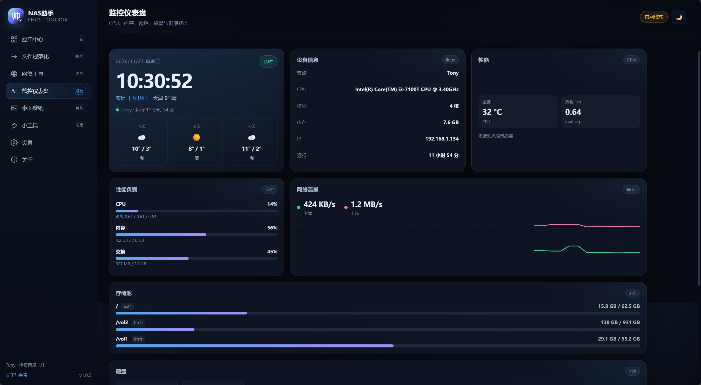
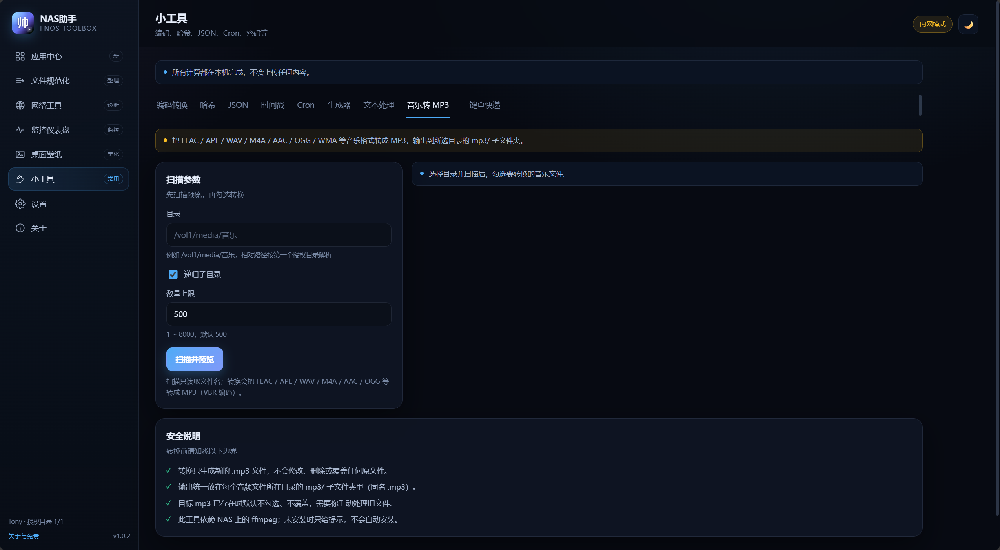

# NAS助手

面向 **飞牛 fnOS** 玩家的一体化本地 Web 工具箱。打包为 Docker 镜像，同时支持 `.fpk` 一键安装；整个程序运行在你自己的 NAS 内，不需要任何公网服务器。

> 只做**配置辅助与模板生成**，不内置、不下载、不分发任何影视资源、音源或字幕。

```
影视文件规范化 · 网络诊断 · 硬盘 SMART · 监控仪表盘 · 常用小工具
```

---

## 为什么做这个

NAS 影音玩家的日常，往往是十几个零散工具拼起来：

- 手写 `docker-compose` 部署常用自托管应用，每次都要翻收藏夹；
- 文件名里混着压制组、分辨率、中文括号，想批量改名又怕脚本写错把文件搞乱；
- 想看一眼硬盘 SMART，还得 SSH 进去敲 `smartctl`；
- 临时要算个子网、转个 Base64，又得打开一堆在线网站。

NAS助手把这些收进一个页面：**能预览的绝不直接写，能只读的绝不修改，能本地算的绝不上传。**

---

## 界面预览

以下均为 v1.0.2 真实运行截图（非设计稿）：

| 应用中心 · 一键部署 |
| --- |
|  |

| 监控仪表盘 |
| --- |
|  |

| 小工具 · 音乐转 MP3 |
| --- |
|  |

---

## 功能一览

| 模块 | 能做什么 | 是否写盘 |
| --- | --- | --- |
| **应用中心** | 常用自托管应用目录、一键生成/部署 Docker Compose、GitHub 最新版本检测 | 写入 compose、创建容器 |
| **文件规范化** | 批量重命名预览、执行、一键撤销、导出 Bash / PowerShell 脚本 | 重命名文件 |
| **网络工具** | Ping、TCP 端口探测、DNS 查询、HTTP 探测、IPv4 子网计算 | 不写入 |
| **监控仪表盘** | CPU/内存/网络/磁盘 IO 实时监控、磁盘信息与 SMART 健康摘要 | 不写入 |
| **硬盘 SMART** | 磁盘健康、温度、通电时间、重映射扇区、挂载点容量 | 不写入 |
| **小工具** | Base64/URL 编码、哈希、JSON 格式化、时间戳、Cron 解析、密码/UUID、文本处理、chmod 解释 | 不写入 |
| **设置** | 统一管理授权目录（文件路径）：应用内新增/移除、目录浏览选点、全盘访问开关、版本/数据目录/密码概览 | 仅写入 `roots.json` 等配置 |

设计原则：

1. **先预览，后执行**：所有写操作默认 dry-run，结果逐条列出。
2. **路径沙箱**：只允许访问 `SS_ROOTS` / fnOS 授权目录内的真实路径，符号链接逃逸也会被拦截。
3. **零第三方依赖**：整个后端只用 Node 内置模块，没有供应链风险，镜像也小。
4. **可撤销**：批量重命名会写撤销日志，随时一键回退。

---

## 快速开始

### 方式一：Docker Compose（推荐）

```yaml
services:
  shuaishuai-nas:
    image: tongtongshuaishuai/nas-helper:latest
    container_name: shuaishuai-nas
    restart: unless-stopped
    ports:
      - "8620:8620"
    environment:
      TZ: Asia/Shanghai
      SS_PASSWORD: "换成一个强密码"
      SS_ROOTS: /vol1/media:/vol2/media
    volumes:
      - /vol1/media:/vol1/media:ro
      - /vol2/media:/vol2/media:ro
      - ./data:/data
```

```bash
docker compose up -d
# 打开 http://NAS的IP:8620
```

需要硬盘 SMART 时追加：

```yaml
    privileged: true
    devices:
      - /dev/sda:/dev/sda
```

也可以自己构建：

```bash
git clone <repo> && cd shuaishuai-nas
docker build -t tongtongshuaishuai/nas-helper:latest .
```

### 方式二：fnOS `.fpk` 一键安装

> 正式安装包（x86 / ARM）已打包并随 **GitHub Releases** 发布（仓库 URL 见下「开源与反馈」），可直接下载 v1.0.0 的 `shuaishuai.nas_1.0.0_x86.fpk` / `_arm.fpk`，无需自行构建。

1. 从 GitHub Releases 下载或自行构建 `dist/shuaishuai.nas_1.0.0_x86.fpk`；
2. 打开 **fnOS 应用中心 → 手动安装**，选择 `.fpk`；
3. 安装向导里可设置访问密码（留空则不启用）；
4. 安装完成后，到 **应用设置 → 授权目录** 添加媒体目录（如 `/vol1/media`）；
5. 桌面点击「NAS助手」即可打开。

构建 `.fpk`（零依赖，不需要 `fnpack`）：

```bash
node scripts/build-fpk.mjs                 # x86
node scripts/build-fpk.mjs --platform arm  # ARM
node scripts/build-fpk.mjs --platform both # 同时产出两个架构
```

产物在 `dist/`，打包细节见 [docs/fnos-packaging.md](docs/fnos-packaging.md)。

### 方式三：源码运行

```bash
npm start
# 默认 http://127.0.0.1:8620
```

需要 Node.js ≥ 18（fnOS 的 `nodejs_v22` 即可）。无需 `npm install`。

---

## 环境变量

| 变量 | 默认值 | 说明 |
| --- | --- | --- |
| `SS_PORT` | `8620` | 监听端口 |
| `SS_HOST` | `0.0.0.0` | 监听地址，只想本机访问可设 `127.0.0.1` |
| `SS_ROOTS` | `/vol1:/vol2:/vol3:/mnt:/media` | 授权目录，多个用 `:` 分隔（Windows 用 `;`） |
| `SS_DATA_DIR` | `./var` | 运行数据（撤销日志、日志） |
| `SS_PASSWORD` | 空 | 设置后所有接口需要登录 |
| `SS_SECRET` | 随机 | Cookie 签名密钥；容器重建后建议固定，否则需重新登录 |
| `SS_LOG` | `1` | 设为 `0` 关闭访问日志 |
| `SS_WEATHER_PROVIDER` | `auto` | 天气数据源。`auto` 先试 Open-Meteo，失败自动回退 `wttr.in`；设为 `wttr` 可强制只用备用源（国内网络访问 Open-Meteo 预报接口时常被阻断） |

> `SS_ROOTS` 是硬边界：路径解析后会与授权目录做包含校验，跨目录、`..`、符号链接逃逸都会被 403。

> Docker 下如果 `./data` 由 root 创建，容器内的 `node` 用户可能无法写入。执行 `sudo chown -R 1000:1000 ./data` 即可（镜像内 node 用户默认 UID 1000）。

---

## 各模块怎么用

### 文件规范化

- 预览阶段会标出**冲突**（目标已存在、同批次重名）；
- 执行前自动写入撤销日志，误操作可一键回退；
- 也可以只导出 Bash / PowerShell 脚本，自己在命令行里先 dry-run。

### 网络工具 / 硬盘 SMART / 小工具

都是即时计算或只读采集，没有副作用。SMART 依赖 `smartctl`，Docker 下需要 `privileged` 与 `/dev` 挂载；fnOS 原生安装则直接读取。

---

## 安全设计

| 风险 | 处理方式 |
| --- | --- |
| 任意文件读写 | `resolveUserPath`：拒绝 NUL/超长路径 → realpath → 必须落在授权根目录内 → 再校验一次 |
| 命令注入 | 只用 `execFile(cmd, args)`，固定程序（ping / smartctl / df），不经过 shell |
| 路径穿越 | `..` 检查 + realpath 双重校验，符号链接解析后再判断 |
| 未授权访问 | 可选 `SS_PASSWORD`，HMAC 签名 Cookie，失败节流（5 次锁 60 秒，400ms 延迟） |
| 供应链 | 零第三方依赖，镜像只装 `smartmontools / iputils / bind-tools` |
| 误操作 | 写操作默认 dry-run；重命名有撤销日志；不触碰授权目录之外的文件 |
| 数据外泄 | 不发起任何第三方请求，所有计算都在本地完成 |

---

## 目录结构

```
shuaishuai-nas/
├── server/                 # 零依赖 Node 后端
│   ├── index.js            # HTTP 服务、路由、静态资源、鉴权
│   ├── lib/                # 路径沙箱、扫描、文件名解析、登录
│   └── routes/             # 各模块 API（自动加载）
├── web/                    # 原生 ES Module 前端
│   ├── index.html / login.html / styles.css / app.js / ui.js
│   └── modules/            # 每个功能页一个模块
├── fpk/                    # fnOS 应用包源（manifest / cmd / config / wizard / ui）
├── scripts/
│   ├── build-fpk.mjs       # 零依赖 .fpk 打包器（自带 tar 写入）
│   ├── selftest.mjs        # 端到端冒烟测试
│   ├── check-all.mjs       # 语法与结构检查
│   └── make-icons.py       # 图标生成
├── Dockerfile
├── docker-compose.yml
└── docs/
```

---

## 开发与测试

```bash
npm start          # 本地起服务
npm run check      # 后端 + 前端语法、JSON、manifest、生命周期脚本检查
npm test           # 启动临时实例，跑 20+ 个端到端断言（含登录与越权测试）
npm run build:fpk  # 生成 .fpk
npm run verify:fpk # 校验 .fpk 结构、校验和与图标
npm run release -- --bump patch --changelog "修复 xxx"
```

测试会在临时目录里造一套假媒体文件，不会碰你的真实数据。

---

## 升级与维护

日常修 bug / 加功能的完整流程：

```bash
npm run check && npm test
npm run release -- --bump patch --changelog "修复重命名撤销日志边界"
# → 自动升版本、打包 x86/arm、校验产物
```

- **fnOS**：用新 `.fpk` 在应用中心直接覆盖安装，`var/` 与授权目录都不动；
- **Docker**：`docker compose build && up -d`，`/data` 卷保留；
- **回滚**：保留旧 `.fpk` / 旧镜像 tag，随时切回。

数据目录（撤销日志、访问密码）、备份命令、忘记密码、升级后 403 等排错，见 [docs/upgrade.md](docs/upgrade.md)。

---

## 已知限制

- **SMART 依赖平台**：非 Linux 平台只显示「不支持」提示；Docker 需要额外权限。
- **重命名不跨文件系统移动**：仅做同分区改名，避免大文件搬运。
- **单用户模型**：没有多用户权限体系，定位是「你自己的 NAS 工具」，请配合 `SS_PASSWORD` 使用。

---

## 免责声明

本工具仅提供配置辅助、目录规范与模板生成能力，**不内置、不提供、不下载、不分发任何影视资源、音乐资源、音源、字幕或刮削数据**。请确保你对自己管理的媒体文件拥有合法权利，并遵守所在地法律法规。批量操作前请自行备份，因使用本工具造成的任何数据损失由使用者自行承担。

---

## License

[MIT](LICENSE) © 2026 统帅帅
