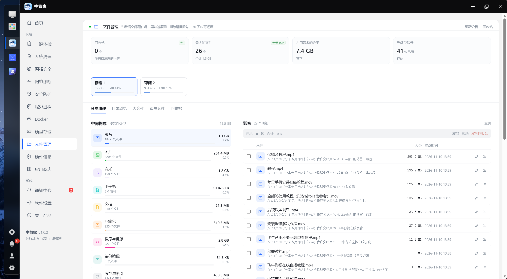
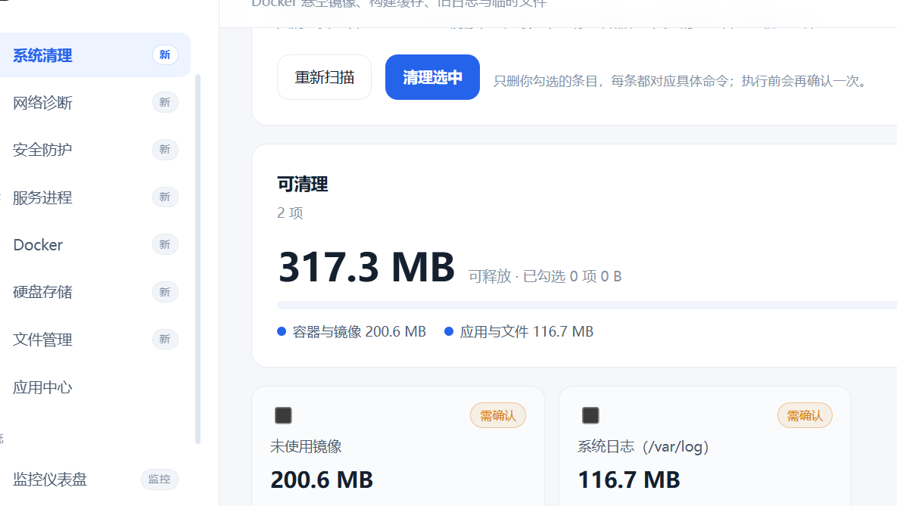
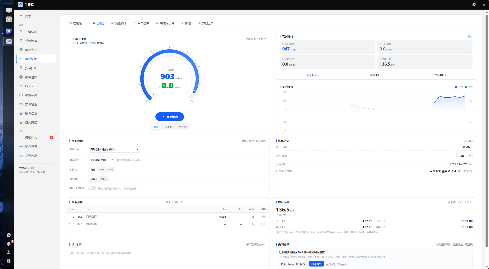
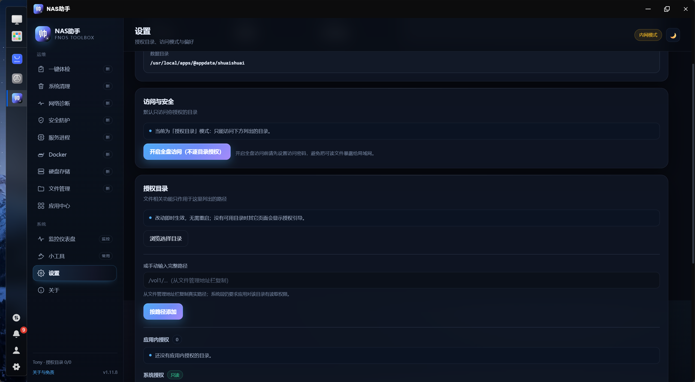

# NAS助手

面向 **飞牛 fnOS** 的本地运维工具箱：一键体检、系统清理、网络诊断（含带宽测速）、安全防护、服务进程、Docker 治理、硬盘存储、文件管理、应用中心、监控仪表盘与常用小工具。

打包为 `.fpk` 一键安装，也可以 Docker 运行。整体在你自己的 NAS 内运行，**不上传任何数据、零第三方依赖**。

```
一键体检 · 系统清理 · 网络诊断/测速 · 安全防护 · 服务进程
Docker · 硬盘存储 · 文件管理 · 应用中心 · 监控 · 小工具
```



---

## 快速开始

### 方式一：fnOS 应用中心安装（推荐）
1. 到 [Releases](https://github.com/84387822-a11y/shuaishuai-nas/releases) 下载对应架构的 `.fpk`（x86 / arm）
2. fnOS 应用中心 → 手动安装 → 选择安装包
3. 安装完成后从桌面图标打开，界面内嵌在 fnOS 窗口里

要求：fnOS ≥ 1.2.1102

### 方式二：Docker
```bash
docker compose up -d
# 默认 http://<NAS-IP>:8620
```

---

## 页面介绍

以下都是真实运行界面（非设计稿），截图见文末。

### 一键体检
把磁盘空间、内存占用、系统负载、硬盘 SMART、Docker 容器状态汇总成一张清单，按「正常 / 注意 / 异常」标出问题，不用逐个页面翻。
> 只读。

### 系统清理
扫描 Docker 悬空镜像、构建缓存、已停止容器、7 天前的系统日志与临时文件；顶部显示可释放总量，按卡片勾选（「安全」项默认选中、「需确认」项需手动勾选），清理前列出每条命令并要求确认。
> 写入：仅删除勾选的清理项。



### 网络诊断
五个标签页：
- **连通性**：常用站点的 DNS 解析 + TCP 时延，一眼看出哪个站点不通；
- **带宽测速**：实时仪表盘 + 曲线，下行/上行峰值、平均、延迟/抖动/丢包，支持双向 / 仅下行 / 仅上行；
- **流量统计**：按网卡统计收发速率；
- **路由追踪**：逐跳探测；
- **局域网设备**：读取系统邻居表（ARP），不做主动扫描。
> 只读探测，不抓包、不改网络配置。



### 安全防护
只读检查：SSH 是否允许 root 直登 / 密码登录 / 默认 22 端口；空密码与 UID 0 账号；对外监听的高危端口（445/3306/6379/9200…）；防火墙（ufw/nftables/iptables）是否生效；最近失败登录记录。给出评分、风险分级与建议。
> 只读，不修改任何系统配置。

### 服务进程
CPU / 内存占用 Top 进程、启动失败的系统服务、监听端口；结束进程带保护名单与二次确认。
> 写入：仅在你确认后结束指定进程。

### Docker 治理
容器列表与启停重启、容器日志查看、镜像清单、磁盘占用统计。
> 写入：仅启停/重启你选中的容器。

### 硬盘存储
磁盘型号、类型（SSD/HDD）、容量、温度、SMART 健康状态，以及各分区占用条（≥75% 变黄、≥90% 变红）。读不到 SMART 时显示「未知」，不会误报异常。
> 只读。

### 文件管理
三个标签页：**分类统计**（按影音/图片/音乐/文档/压缩包等统计空间构成 + 最大文件 Top 50）、**目录浏览**（逐层浏览目录）、**大文件**（按大小排行）。
未授权目录时自动以存储卷（`/vol*`、`/home`、`/mnt`、`/media`）作为只读浏览根。
> 只读，不删除、不移动。

### 应用中心
预置常用自托管应用目录，选择数据目录与端口后一键生成并部署 Docker Compose，附 GitHub 版本检测。
> 写入：生成 compose、创建容器。

### 监控仪表盘
CPU、内存、网络、磁盘 IO 实时曲线，磁盘信息与 SMART 摘要。

### 小工具
「文件规范化」批量重命名（预览 → 执行 → 撤销 → 导出脚本），以及 Base64/URL 编码、哈希、JSON 格式化、时间戳、Cron 解析、密码/UUID、文本处理等。

### 设置 / 关于
设置：主题（浅色/深色/跟随系统）、默认首页、紧凑模式、操作二次确认。
关于：产品介绍、微信群/支付宝/QQ 群、版本检测与 Releases 入口。



---

## 设计原则

1. **默认只读**：能读的绝不写；所有写操作（清理、停止容器、结束进程）都要二次确认。
2. **路径边界**：文件类功能只访问授权目录或存储卷内的真实路径，符号链接逃逸会被拦截。
3. **零第三方依赖**：后端只用 Node 内置模块，前端原生 ES Module，无构建步骤、无供应链风险。
4. **数据不出本机**：不连接任何第三方服务器，仅「版本检测」会读取公开的 GitHub Releases 信息。

---

## 开发

```bash
npm run check    # 语法 + 静态检查
npm test         # 端到端冒烟测试
npm start        # 本地运行（默认 8620）
npm run build:fpk        # 打 x86 包
npm run build:fpk -- --platform both   # x86 + arm
```

目录结构：

```
server/        Node 后端（routes/ 自动加载，lib/ 工具与沙箱）
web/           前端（app.js 外壳，modules/ 每页一个模块）
fpk/           fnOS 打包配置（manifest / ui / cmd / wizard）
scripts/       构建、校验、自测、发布脚本
docs/          文档与截图
```

---

## 安全与免责

本工具只提供本地运维辅助，所有操作由你自行发起并承担结果；执行清理、停止服务、结束进程等操作前请确认影响范围。作者不对误操作造成的数据丢失或服务中断负责。第三方应用与镜像的版权归各自作者所有。

## 许可证

[MIT](LICENSE)
